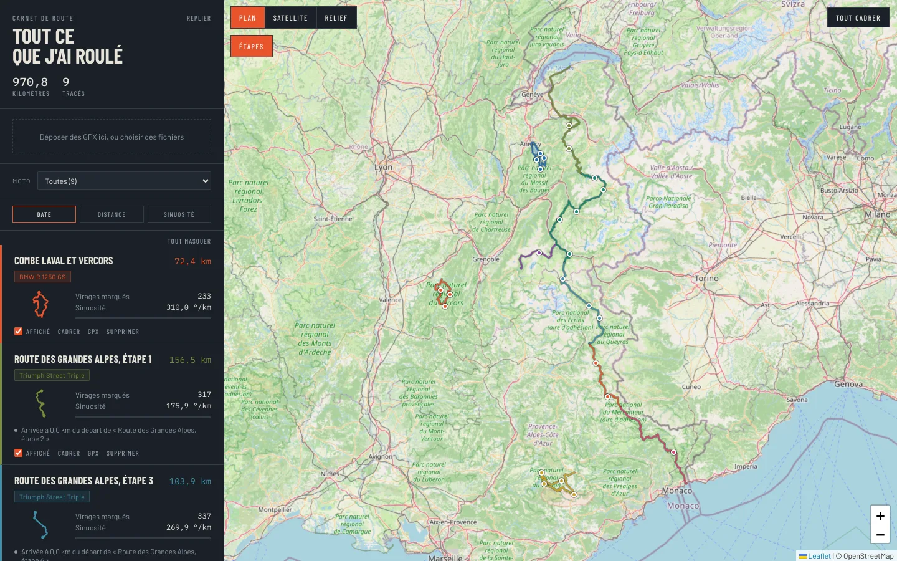

# Carnet de route

**Tous tes trajets moto sur une seule carte.**

Carnet de route lit les fichiers GPX de tes balades (exportés de Liberty Rider
ou de n'importe quel GPS) et les affiche ensemble sur une carte. Pour chaque
trajet, il calcule la distance, le nombre de virages et la sinuosité. Tout
tourne sur ta machine : tes trajets ne partent nulle part.



## Fonctionnalités

- **Import par glisser-déposer**, plusieurs fichiers à la fois, ou d'un dossier
  entier en ligne de commande.
- **Carte** : tous les tracés en couleur, fonds Plan, Satellite et Relief,
  points d'étape. Un clic sur un tracé retrouve sa fiche dans la liste.
- **Statistiques par trajet** : distance, virages marqués et sinuosité en °/km,
  de quoi distinguer un transfert d'autoroute d'une vraie route de col.
- **Tri** par date, distance ou sinuosité.
- **Motos** : chaque trajet porte sa moto, et un filtre isole les trajets d'une
  moto en recalculant les totaux.
- **Raccords** : les trajets qui s'enchaînent (arrivée à moins de 3 km d'un
  départ) sont signalés, pratique pour retrouver les étapes d'un roadtrip.
- **Gestion** : renommer, masquer, cadrer, re-télécharger le GPX d'origine,
  supprimer (le fichier part dans une corbeille, pas à la poubelle).

## Démarrer

Prérequis : Node.js 22 ou plus.

```bash
git clone https://gitlab.com/AnselmeSDR/carnet-de-route.git
cd carnet-de-route
npm install
npm run dev
```

L'app s'ouvre sur http://localhost:5173. Dépose tes GPX dans le panneau de
gauche.

> L'app est faite pour tourner en local : son API n'a pas d'authentification.
> Ne l'expose pas sur un réseau.

## Importer beaucoup de trajets

```bash
npm run import -- chemin/vers/mes-gpx   # copie les GPX dans data/gpx/
npm run reindex                         # recalcule l'index
```

`import` ne recopie ni un trajet déjà présent, ni un trajet supprimé depuis
l'app.

### Titres et motos

Un GPX ne contient en général ni titre lisible ni moto. Si tu as un CSV avec
les colonnes `ride_id` (l'identifiant que Liberty Rider écrit dans le GPX),
`nom` et `vehicule` :

```bash
npm run motos -- trajets.csv
npm run reindex -- --motos
```

Sinon, titre et moto se changent à la main depuis la liste.

## Tes données

Tout reste dans `data/`, sur ta machine : les GPX d'origine (jamais modifiés),
l'index des statistiques et les tracés simplifiés pour la carte. Le dossier est
exclu de git. Ni base de données, ni compte, ni envoi en ligne, à part le
chargement des fonds de carte.

## Sous le capot

React, Leaflet et Vite. Le GPX est analysé dans le navigateur, sans
dépendance ; le serveur de Vite porte une petite API qui ne fait qu'écrire les
fichiers. Les statistiques sont calculées une fois à l'import et rangées dans
un index JSON. Fonds de carte : OpenStreetMap, Esri, OpenTopoMap.

## Licence

[AGPL-3.0](LICENSE) — libre d'utiliser, de modifier et de partager ; toute
version modifiée, distribuée ou proposée en ligne doit rester open source sous
la même licence. Une licence commerciale est disponible pour un usage en code
fermé : anselme8@icloud.com.
